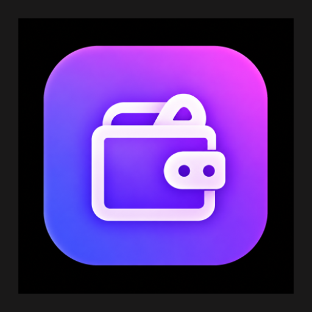
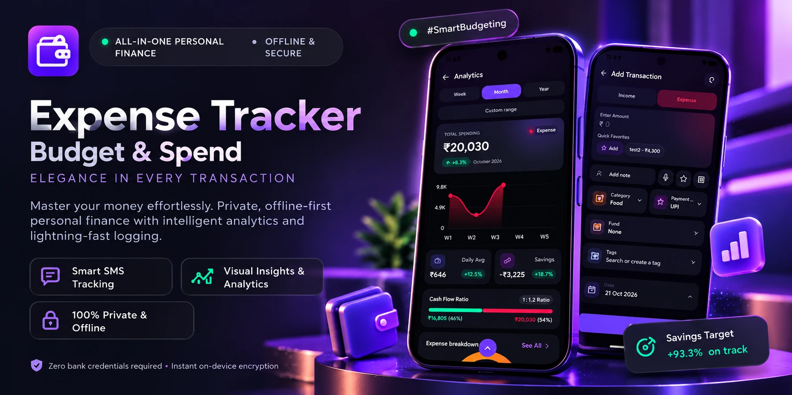
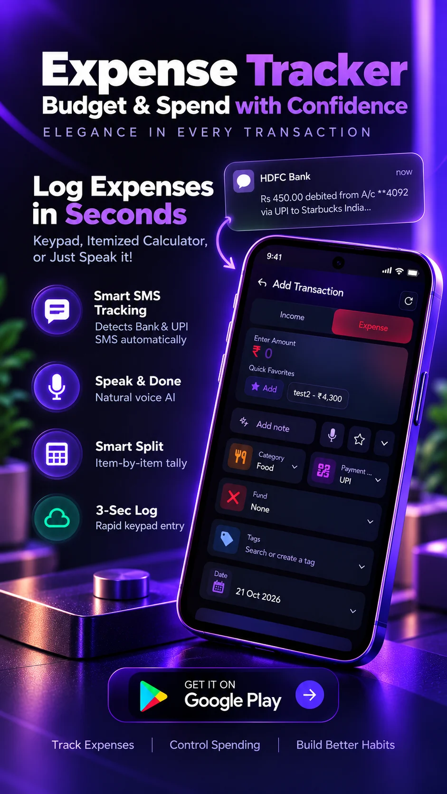
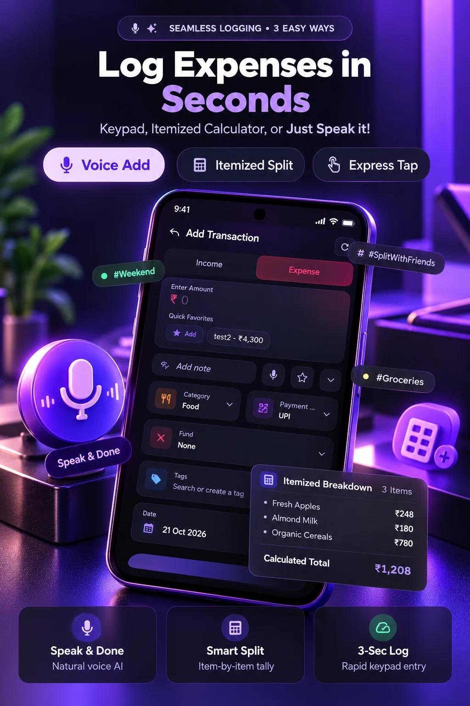
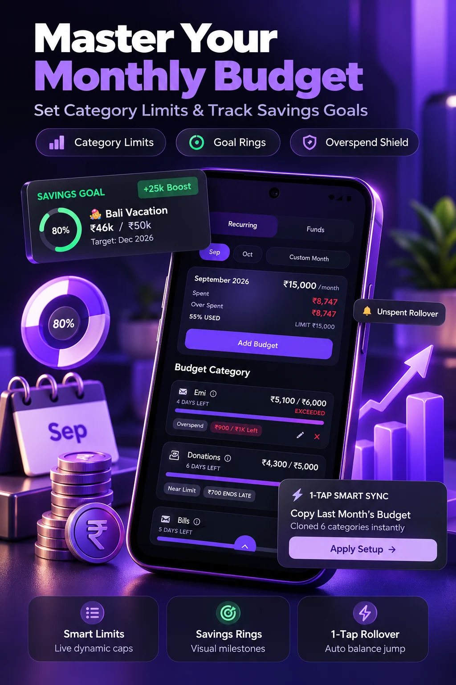
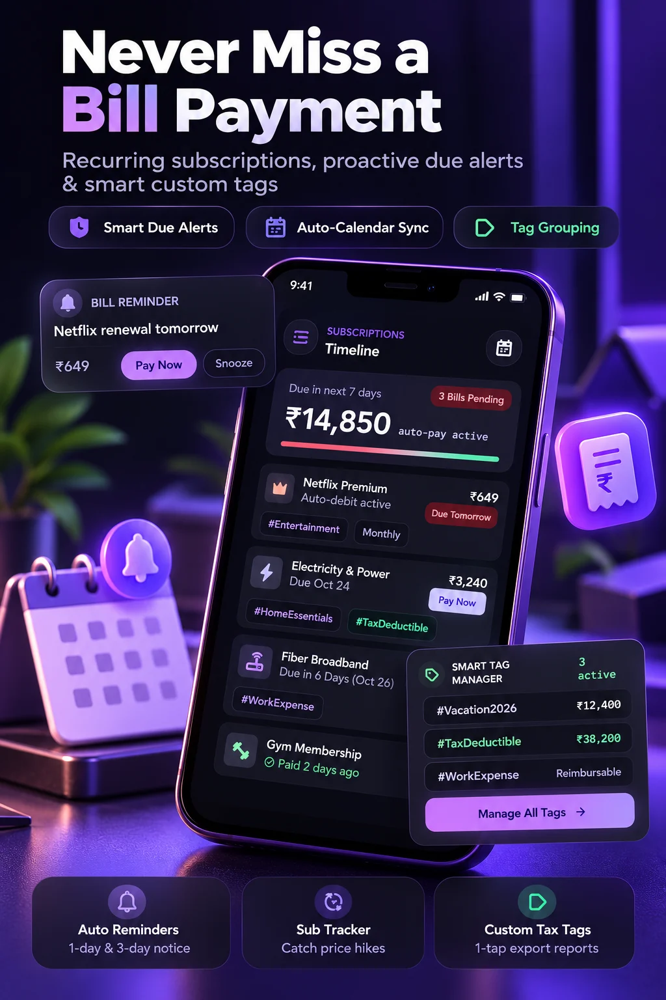
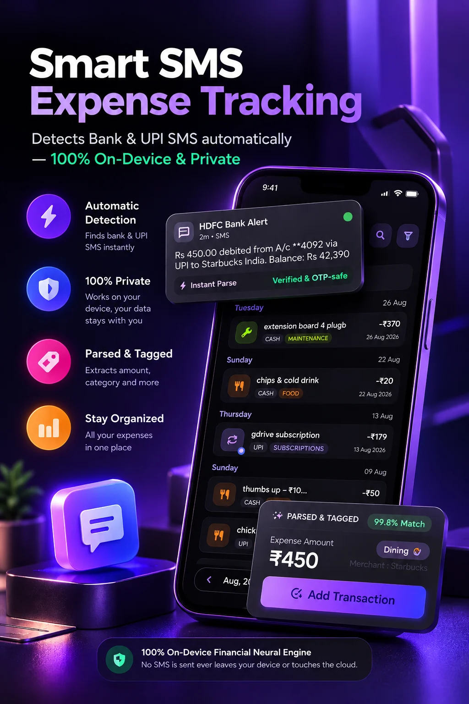

<div align="center">

# 💰 Expense Tracker: Budget & Spend

**An elegant, offline-first personal finance app for Android — built with Jetpack Compose & Material 3.**

    



*Premium by Design, Private by Nature.*

</div>

---

## 📱 About

**Expense Tracker: Budget & Spend** is a privacy-focused personal finance app. Log spending by **typing, talking, or scanning**, share a bill from any payment app, or use optional **SMS-based money management**: with `RECEIVE_SMS`, incoming bank / UPI / wallet debit-credit messages are parsed **on-device** and listed as suggestions you review before anything is saved. Plan monthly budgets, funds, and goals; visualize habits with analytics; and lock the app with PIN/biometrics. The app is **offline-first** — your data never leaves the device unless you sign in and enable cloud sync.

The app is **not** a default SMS handler, does **not** request `READ_SMS` or `SEND_SMS`, does **not** send 5-digit payment SMS or use SMS for OTP/fraud, and does **not** upload SMS content. Non-financial SMS (OTP, promo, no amount) are ignored.

| | |
|---|---|
| **Application ID** | `com.mknlabs.expensetracker` |
| **Version** | 2.259.30 |
| **Min SDK / Target SDK** | 24 / 36 |
| **Language** | 100% Kotlin |
| **UI** | Jetpack Compose (Material 3) |
| **Architecture** | MVVM · Clean-style (data / domain / ui) |

---

## 📸 Screenshots

Same gallery as the [website](https://expense-tracker-2ea00.web.app/#screenshots).

<p align="center">
  
</p>

| Overview | Fast logging | Budgets |
|---|---|---|
|  |  |  |

| Bills | Insights | Smart SMS |
|---|---|---|
|  |  |  |

---

## ✨ Features

### 💬 SMS-based money management (optional)
- Optional **`RECEIVE_SMS` only** — off until you grant it on Home; deny and the feature stays off
- Incoming **bank / UPI / wallet** SMS are parsed locally; OTP, promo, and messages with no amount are dropped
- Suggestions appear under **Detected Transactions** (Home ⋮). Tap a card to open Add Transaction, edit if needed, then press **Add**. Swipe deletes a suggestion. Nothing is booked without that confirmation
- SMS bodies are **not uploaded, sold, or shared**. Confirmed transactions follow the same local (and optional cloud-sync) path as keypad entries

### ✨ Type, talk, scan & share
- One add sheet: **write it like a message**, **speak it**, or **scan a receipt** — amount, merchant, and category are parsed for review
- **Share from any payment app** (GPay, PhonePe, Paytm, bank apps, and more) — bill, receipt, or payment screen via the system Share sheet
- **Receipt OCR** — photo, image, or PDF; review amount, funds, and tags, then confirm
- **Voice add** — optional mic; on-device parsing, with AI help for messier phrasing (daily free limit)

### 🧾 Transactions
- Log **income & expenses** in seconds with a dedicated amount keypad and smart category ranking
- Add **notes**, **categories** (50+ icons, fully customizable), **payment methods/wallets**, and **tags**
- **Itemized calculator** — split one payment into line items with a running total; history kept
- **Quick favorites** (Pro) — reuse frequent entries in one tap
- Advanced **search, sort & multi-filter** (date range, amount range, category, payment mode, type, order)
- Fully customizable **transaction cards** (icons, labels, date/time visibility, grouping)

### 📊 Budget, Funds & Goals
- **Monthly category budgets** with caps, spent/remaining/over tracking and limit alerts
- **Funds** — named buckets (holiday, car, wedding) with allocated / spent / remaining
- **Savings goals** with progress tracking; fund goals from transactions
- **Recurring transactions** (Pro) — daily/weekly/monthly/yearly bills, rent, salary
- **EMI & installments** (Pro) — pay, skip, or undo individual installments with paid history

### 🔖 Tags
- Label spending across categories (trip, project) with a **tag breakdown in Analytics**

### 📈 Analytics
- Weekly / monthly / yearly / **custom range** analytics
- Spending trends, growth index, cash-flow ratio, average daily spend
- **Top spending** by category & payment mode, full category/payment breakdowns
- Smart **spending insights** with actionable tips

### 🗓️ Calendar
- Year & month views with per-day spending overview
- Jump-to-date navigation and month/year pickers

### 🔒 Security & Privacy (offline-first)
- **App lock**: 4-digit PIN, biometric (fingerprint/face), scrambled keypad, security-question recovery
- **Block screenshots**, **blur in recents**, configurable auto-lock duration
- Data stored locally (Room + encrypted DataStore); never uploaded unless you sign in
- **Server-verified Pro**: ProPass redemption runs through a trusted Cloud Function — Pro status can only be granted server-side, never tampered with on-device

### ☁️ Cloud Sync & Data Management
- Sign in with **Google, email/password, or magic link** (deep-link support)
- **Cross-device sync** via Firebase Firestore (see connected devices)
- **JSON export/import** (merge-safe), **SQLite `.db` backup/restore**, **legacy app import**
- **Automated backups** via WorkManager with configurable frequency

### 🔔 Notifications
- **Notification center** you control: expense reminders, budget thresholds, large transactions, weekly summaries, goal milestones, bill reminders, backup and sync status

### 🎨 Personalization
- **Multi-currency** with country search; Indian or international digit grouping; decimal places; date & time formats; billing-cycle start day
- System / Light / Dark themes, language, profile (avatar, DOB, gender), customizable categories
- **Adaptive layout** — phone, tablet, foldable; side menu on large screens; larger system text never breaks a card

### 🎁 Refer & Earn
- Invite a friend — you both get **free Pro days** (up to 16 days of Pro per month), with progress in the app

### 👑 Monetization
- **AdMob** (native, interstitial, rewarded) with **UMP** consent management
- **Pro membership** (server-verified Pro Pass redemption) unlocking: ad-free UI, advanced analytics, recurring rules, EMI, favorites, cloud sync & auto backup
- Watch-a-rewarded-ad to unlock temporary ad-free Pro access (length is set by the `ad_pass_duration_minutes` Remote Config parameter, so the app never advertises a fixed duration)

---

## 🛠️ Tech Stack

| Layer | Technology |
|---|---|
| **Language** | Kotlin 2.2.10 |
| **UI** | Jetpack Compose, Material 3, Material Icons Extended, Splash Screen API |
| **DI** | Hilt (with Hilt-ViewModel & Hilt-Worker) |
| **Local DB** | Room 2.8.4 (KSP), DataStore Preferences |
| **Backend** | Firebase Auth, Firestore, Remote Config, Analytics, Cloud Functions (ProPass redemption), Google Sign-In |
| **Background** | WorkManager (sync, recurring rules, auto-backup, notifications) |
| **Ads** | Google AdMob + User Messaging Platform (UMP) |
| **Security** | Android Biometric, Security Crypto (EncryptedSharedPreferences), PBKDF2 PIN hashing with lockout, Keystore AES-256-GCM encrypted DataStore & backups, root/emulator detection, server-authoritative Pro (Cloud Function) |
| **Performance** | Baseline Profiles (separate `:baselineprofile` module) |
| **Build** | Gradle 9.5 · AGP 9.3.1 · Version Catalog (`gradle/libs.versions.toml`) |

---

## 🏗️ Architecture

The app follows a **Clean-style MVVM** architecture with a one-way data flow:

```
UI (Compose) → ViewModel (UiState) → UseCase → Repository → Data Source (Room / Firebase / DataStore)
```

- **`ui/`** — Compose screens, components, navigation, themes & ViewModels
- **`domain/`** — use cases & repository interfaces (business rules)
- **`data/`** — Room entities/DAOs, repository implementations, DataStore, Firestore sync, legacy import
- **`di/`** — Hilt modules (Database, Auth, DataStore, Firebase, Monetization, Repository)
- **`workers/`** — WorkManager workers (cloud sync, recurring transactions, auto-backup, notifications)
- **`notifications/`** — dynamic notification engine & scheduling
- **`monetization/`** — ads coordinator, feature registry & access-level gating

```
📦 com.mknlabs.expensetracker
 ┣ 📂 data          # Room, repositories, DataStore, Firestore sync
 ┣ 📂 di            # Hilt modules
 ┣ 📂 domain        # Use cases & repository contracts
 ┣ 📂 monetization  # Ads + Pro feature gating
 ┣ 📂 notifications # Notification engine & workers
 ┣ 📂 ui            # Screens, components, navigation, theme, viewmodels
 ┣ 📂 utils         # Formatting, sorting, auth helpers
 ┣ 📂 workers       # WorkManager background tasks
```

---

## 🚀 Getting Started

### Prerequisites

- **Android Studio** (latest stable, with **JDK 21** — see `gradle/gradle-daemon-jvm.properties`)
- **Android SDK 36**
- A [Firebase](https://firebase.google.com) project (for auth, sync & analytics)

### 1. Clone & build

```bash
git clone <your-repo-url>
cd ExpenseTracker

# Build debug APK
./gradlew :app:assembleDebug

# Run unit tests
./gradlew :app:testDebugUnitTest
```

### 2. Add your Firebase config

The repository **does not include** `app/google-services.json` (it contains your Firebase API keys and is git-ignored).

1. Create a project in the [Firebase Console](https://console.firebase.google.com)
2. Add an **Android app** with package name `com.mknlabs.expensetracker`
3. Download the generated `google-services.json` into the `app/` folder
4. Enable **Firebase Authentication** (Email/Password, Google, and Dynamic Links/Magic Link) and **Cloud Firestore**

### 3. Deploy Cloud Functions & Firestore rules (required for Pro Pass)

```bash
cd functions && npm install
firebase login
firebase deploy --only functions,firestore:rules
```

> ⚠️ Cloud Functions requires the Firebase **Blaze** (pay-as-you-go) plan — it is not available on the free Spark plan. The `redeemProPass` function and the hardened Firestore rules must be deployed before Pro Pass redemption works in a build.

### 4. AdMob (optional)

Add your own **AdMob App ID** and ad-unit IDs. Ad unit IDs currently live in:

- `AndroidManifest.xml` → `com.google.android.gms.ads.APPLICATION_ID`
- `monetization/AdsCoordinator.kt` → native/interstitial/rewarded ad unit constants

> ⚠️ Test ads (`ca-app-pub-3940256099942544/...`) are included for development — replace them with your production IDs before release.

---

## 🧪 Testing

Unit tests live under `app/src/test/` covering:

- Amount formatting & currency utilities
- Date/time utilities
- Category ranking & string utilities
- Navigation utilities
- ViewModels (Analytics, Preferences, Transactions)
- Transaction presentation mapper

Run them with:

```bash
./gradlew :app:testDebugUnitTest
```

---

## 📄 License

Copyright © 2026 **Manish Nayak**. **All rights reserved.**

This project is proprietary and is **not** licensed for redistribution, modification, or commercial use. See the [LICENSE](LICENSE) file for the full terms.

---

## 🙌 Contributing

This is a personal project, but issues, feature requests, and ideas are welcome via GitHub Issues.
